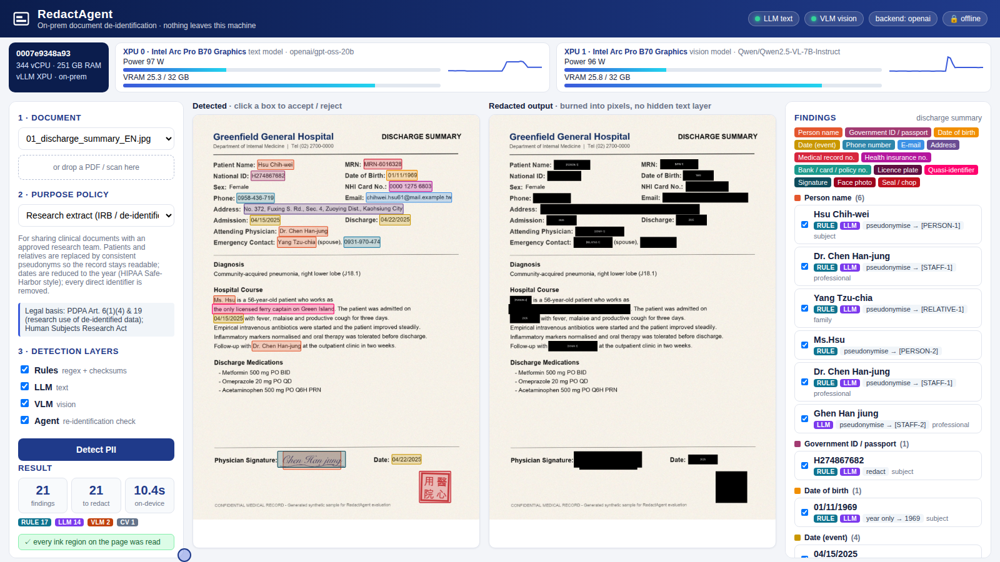
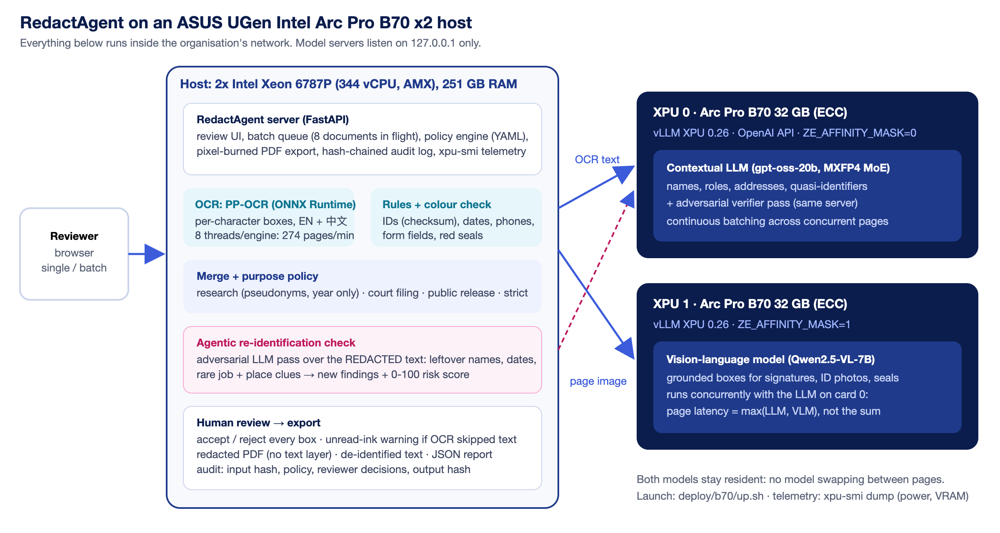

# RedactAgent

**On-premises AI that finds and removes personal data from scanned documents** – so hospitals,
law firms and government agencies can share records without the records ever leaving the building.

**2026 ASUS UGen AI League – Final** · Battlefield **Thunderstorm** (ASUS UGen Intel Arc Pro B70) ·
Theme **Workplace AI** · Global Online Track · Yu-Tsen Tsai (蔡侑岑), CSIE, National Taiwan University.

| | |
|---|---|
| Final demo video (≤ 10 min) | _to be added_ |
| Stage I demo (3 min) | https://youtu.be/LxvyFA2Zhrc |
| Engineering log (Stage II) | [`docs/STAGE2_LOG.md`](docs/STAGE2_LOG.md) |
| Model information | [`docs/MODELS.md`](docs/MODELS.md) |
| Integration (hot folder, REST API) | [`docs/INTEGRATION.md`](docs/INTEGRATION.md) |
| Performance data | [`eval/results_b70/`](eval/results_b70/) · [`eval/tune3/`](eval/tune3/) |



## What it does

1. **Ingest** a PDF, scan or phone photo (English + Traditional Chinese), one or a whole batch.
2. **Read** it with PP-OCR (RapidOCR / ONNX Runtime) – one box per character.
3. **Detect** personal data with complementary layers
   - **Rules** – regex + checksums (Taiwan national ID, Luhn cards, NHI, MRN, ROC dates …), form-field anchoring
     (姓名 / 住址 / Name / Address / court-judgment party lines), organisation letterheads excluded.
   - **Contextual LLM** (gpt-oss-20b on the B70, Qwen3-8B on a laptop) – names in prose, addresses, each person's *role*, quasi-identifiers
     ("the only ferry captain on Green Island").
   - **Vision** (Qwen2.5-VL grounding + red-ink colour segmentation) – signatures, ID photos, seals (印章).
   - **Agentic re-identification check** – an adversarial LLM pass reads the *redacted* text, reports anything that
     could still identify a person and gives the page a 0–100 re-identification risk score.
4. **Decide** with a purpose policy (YAML): research (IRB), court filing, public release (FOI) or strict –
   redact, pseudonymise consistently (`[PERSON-1]`), keep the year only, or keep.
5. **Review** every box in the browser; an unread-ink check flags any text the OCR skipped.
6. **Export** a pixel-burned PDF (no hidden text layer), de-identified text and a JSON report; every step is
   appended to a **SHA-256 hash-chained audit log**.

Nothing is sent to the internet: OCR, models and audit all run on the machine.

## Architecture on 2x Intel Arc Pro B70



Each Arc Pro B70 serves one model through vLLM XPU (`ZE_AFFINITY_MASK=0` text LLM, `=1` vision model), so the LLM
and VLM layers of a page run concurrently and both models stay resident. OCR and rules run on the Xeon host.
Pages: `/` single-document review, `/batch` many documents in flight, `/system` live host / GPU / model status.

## Results (2x Arc Pro B70, final configuration)

Text model **gpt-oss-20b** (MXFP4, native XPU kernel; greedy decoding + loop guard) on card 0, **Qwen2.5-VL-7B**
on card 1, both on vLLM XPU 0.33, 8 pages in flight, strict policy. Recall / precision in %, pixel-level scoring;
a page that fails to process counts as fully leaked.

| Corpus | Pages / PII items | Rules only (regex/DLP baseline) | **RedactAgent (all layers + agentic check)** | Pages with zero leaks |
|---|---|---|---|---|
| v1 development | 36 / 582 | 75.4 / 98.6 | **98.5 / 98.4** | 81 % |
| v2 held-out (used for error analysis) | 30 / 396 | 59.6 / 92.3 | **96.7 / 92.9** | 70 % |
| **v3 never used for development** | 30 / 396 | 59.3 / 93.4 | **96.7 / 96.0** | 63 % |

v3 has been evaluated three times in total, each time once with a configuration fixed on v1/v2 and never for
tuning: 96.7 / 94.8 (final run 1), 96.2 / 95.0 (run 2), 96.7 / 96.0 (run 3, above). All three are in
[`eval/results_b70/`](eval/results_b70/) and [`docs/STAGE2_LOG.md`](docs/STAGE2_LOG.md).

**Throughput and energy** (full pipeline incl. agentic check, board power of both cards from `xpu-smi`):

| Mode | Pages in flight | Pages / min | Latency p50 / p95 | GPU power | v3 recall / precision |
|---|---|---|---|---|---|
| Accuracy (default: greedy + loop guard) | 8 | 21.0 | 15.2 / 39.6 s | 362 W | 96.7 / 96.0 |
| Accuracy | 16 | 25.5 | 23.4 / 58.2 s | 347 W | |
| Throughput (`RA_TEMPERATURE=1.0`) | 8 | 34.7 | 11.6 / 21.2 s | 382 W | 96.0 / 94.5 |
| Throughput | 16 | 42.2 | 18.4 / 28.2 s | 365 W | |

Raw data: [`eval/results_b70/bench/`](eval/results_b70/bench/), [`eval/results_b70/fast/`](eval/results_b70/fast/).
Model selection: four text models compared on the same hardware – [`docs/MODELS.md`](docs/MODELS.md).
Every measurement and what it changed: [`docs/STAGE2_LOG.md`](docs/STAGE2_LOG.md).

Highlights of the Stage II engineering:

- **OCR, not the GPU, was the first bottleneck** – 344 cores of ONNX threads fighting each other; capping threads per
  engine made OCR 9x faster.
- **One model per card**, LLM and VLM layers of a page run concurrently.
- **FP8** made Qwen3-8B 75 % faster at the same accuracy; **gpt-oss-20b** was chosen for the best held-out accuracy.
- **Two modes, one model**: accuracy mode decodes greedily; throughput mode samples gpt-oss at temperature 1.0
  (`RA_TEMPERATURE=1.0`) – no reasoning loops and ~40 % more pages per minute, ~2 recall points lower on v2.
- **Held-out documents exposed a generalisation gap** (84 % recall on new document types); general fixes plus the
  agentic re-identification check closed most of it, confirmed on the v3 corpus that was never used for development.
- **Reasoning loops at scale**: greedy gpt-oss occasionally repeats its reasoning until the token cap. Streaming
  every call in an observe mode showed most loops end by themselves; the **loop guard** cancels only a loop still
  running after 2,000 tokens and resamples. vLLM XPU 0.26 → 0.33 removed bursts of garbage output. A repetition
  penalty looked like a fix but destabilised the server – measured, documented, dropped.
- An evaluation bug (failed pages silently skipped) was found and fixed during model selection.

## Quick start

### On an Intel Arc Pro B70 x2 host (vLLM XPU)

```bash
git clone https://github.com/bananabbgun/RedactAgent.git && cd RedactAgent
bash deploy/b70/up.sh            # pulls models, starts one vLLM server per card, then the web UI on :8080
```

Model choice and quantisation are environment variables (see the header of `deploy/b70/up.sh`).

### On a laptop (Ollama)

```bash
ollama pull qwen3:8b && ollama pull qwen2.5vl:7b
python3.12 -m venv .venv && source .venv/bin/activate && pip install -r requirements.txt
python -m redactagent.server        # http://127.0.0.1:8080
```

## Reproducing the evaluation

| Corpus | Purpose | Pages / PII items |
|---|---|---|
| `data/synthetic` (v1) | development: six document types used while writing prompts and rules | 36 / 582 |
| `data/synthetic_v2` | held-out: five new document types, unseen quasi-identifiers, half phone photos; used for error analysis | 30 / 396 |
| `data/synthetic_v3` | final check: v2 document types with a fresh seed, generated before any result was seen | 30 / 396 |

```bash
python eval/evaluate.py --workers 8 --data data/synthetic_v3 --out eval/results_b70/v3   # recall / precision, ablations A-D
python eval/benchmark.py --levels 1,4,8,16 --out eval/results_b70/bench                    # throughput, latency, power
python -m pytest -q tests                                                                 # unit tests (no models needed)
```

Scoring is pixel-level: a ground-truth item counts as removed when ≥ 50 % of its area is covered by redaction boxes;
a redaction box is correct when ≥ 30 % of its area overlaps ground-truth PII. Ablations: A rules + colour,
B + contextual LLM, C + VLM, D + agentic re-identification check.

A small user study (manual vs. AI-assisted redaction, `/study`, scored with `eval/study_score.py`) measures time
per page and completeness with people in the loop.

## Repository layout

| Path | Content |
|---|---|
| `redactagent/` | pipeline, OCR, detectors (`rules.py`, `llm.py`, `vision.py`), agentic `verifier.py`, policy engine, renderer, audit log, hardware telemetry, server |
| `web/` | review UI, batch page, system page, user-study page (vanilla JS, works offline) |
| `policies/` | purpose policies (YAML) |
| `scripts/` | synthetic corpus generators (v1, v2/v3), demo recording and video tooling |
| `eval/` | evaluation harness, benchmark, study scorer, results (`results/` laptop, `results_b70/`, `tune3/` model sweep) |
| `deploy/b70/` | one-command deployment for the Arc Pro B70 host |
| `docs/` | architecture diagram, model information, Stage II engineering log |
| `deck/` | proposal deck source |
| `tests/` | unit tests |

## Models and licences

All Apache-2.0 / MIT / BSD – see [`docs/MODELS.md`](docs/MODELS.md). No AGPL components, so the work can be licensed
for commercial use as the competition requires. RedactAgent itself is MIT.

## Data

All documents in this repository are **synthetic**: every name, ID number (with valid checksum), address and
account was randomly generated. No real personal data was used.

## Notes and limitations

- Policy legal bases are indicative and must be confirmed with counsel for each deployment.
- Synthetic documents approximate real scans; a supervised pilot on real documents is the next step.
- Human review stays mandatory: RedactAgent pre-marks, a person approves.
- XPU graph mode could not be used on this software stack (graph capture ran out of resources); all numbers are eager mode.
