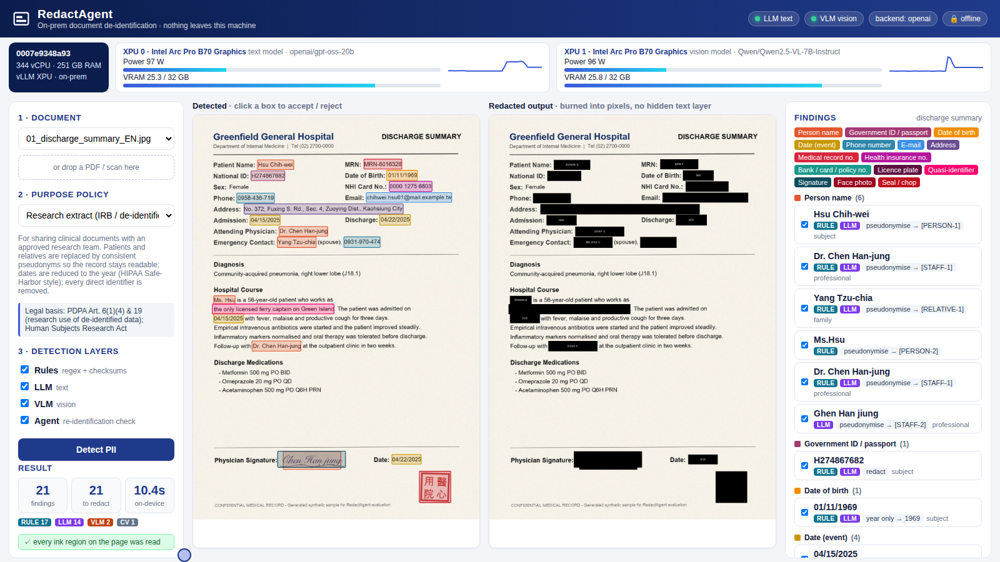
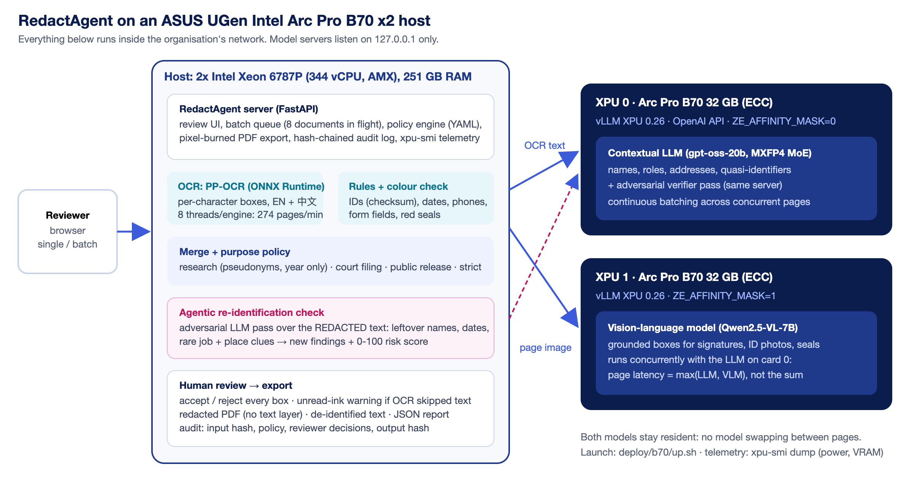

# RedactAgent

**On-premises AI that finds and removes personal data from scanned documents** – so organisations can share
records without the records ever leaving the building. First customer: hospitals.

**2026 ASUS UGen AI League – Final** · Battlefield **Thunderstorm** (ASUS UGen Intel Arc Pro B70) ·
Theme **Workplace AI** · Global Online Track · Yu-Tsen Tsai (蔡侑岑), CSIE, National Taiwan University.

| | |
|---|---|
| Final demo video (≤ 10 min) | _to be added_ |
| Stage I demo (3 min) | https://youtu.be/LxvyFA2Zhrc |
| Engineering log (Stage II) | [`docs/STAGE2_LOG.md`](docs/STAGE2_LOG.md) |
| Model information | [`docs/MODELS.md`](docs/MODELS.md) |
| Integration (hot folder, REST API) | [`docs/INTEGRATION.md`](docs/INTEGRATION.md) |
| Market, regulation and competitors | [`docs/MARKET_RESEARCH.md`](docs/MARKET_RESEARCH.md) |
| Performance data | [`eval/results_b70/`](eval/results_b70/) · [`eval/tune3/`](eval/tune3/) |

This README follows the same six chapters as the video and the deck: the problem, our idea, the hospital case,
proof, what we built on the B70, and why it is ready. Reproduction steps and reference material come after them.

## 1 · The problem

Every workplace hands out documents about people: hospitals release charts, courts publish judgments, insurers pass
on claims, agencies answer information requests. Each copy must have its names, ID numbers, addresses, signatures
and seals removed first – today, mostly by hand.

- **People miss things.** In a published study, single reviewers found only 81 % of the identifiers
  (Neamatullah et al. 2008).
- **The stakes are rising.** Taiwan's PDPA amendment (Nov 2025) adds breach notification and a dedicated
  regulator; security failures can cost up to NT$15M.
- **No existing product meets all four needs** a tool for these documents has: run inside the organisation, read
  Traditional Chinese and Taiwan IDs, handle scans with seals and signatures, and check whether anyone can still
  be identified. Cloud services (Google Cloud SDP, Microsoft Azure AI Language PII, AWS and Azure medical
  de-identification) fail the first; tools that run on premises (Presidio, Private AI, John Snow Labs) have no
  ready Traditional Chinese; none checks whether someone can still be identified. Sources and the full comparison:
  [`docs/MARKET_RESEARCH.md`](docs/MARKET_RESEARCH.md).

## 2 · Our idea: detect, attack, decide

1. **Ingest** a PDF, scan or phone photo (English + Traditional Chinese), one or a whole batch.
2. **Read** it with PP-OCR (RapidOCR / ONNX Runtime) – one box per character.
3. **Detect** personal data with complementary layers
   - **Rules** – regex + checksums (Taiwan national ID, Luhn cards, NHI, MRN, ROC dates …), form-field anchoring
     (姓名 / 住址 / Name / Address / court-judgment party lines), organisation letterheads excluded.
   - **Contextual LLM** (gpt-oss-20b on the B70, Qwen3-8B on a laptop) – names in prose, addresses, each person's *role*, quasi-identifiers.
   - **Vision** (Qwen2.5-VL grounding + red-ink colour segmentation) – signatures, ID photos, seals (印章).
4. **Attack** – an adversarial LLM pass (the agentic re-identification check) reads the *redacted* text like an
   attacker, reports anything that could still identify a person and gives the page a 0–100 re-identification risk score.
5. **Decide** with a purpose policy (YAML): research (IRB), court filing, public release (FOI) or strict –
   redact, pseudonymise consistently (`[PERSON-1]`), keep the year only, or keep.
6. **Review** every box in the browser; an unread-ink check flags any text the OCR skipped. A person approves.
7. **Export** a pixel-burned PDF (no hidden text layer), de-identified text and a JSON report; every step is
   appended to a **SHA-256 hash-chained audit log**.

Why attack? Privacy fails on combinations. The name is gone, but *"the only licensed ferry captain on Green Island"*
is still one person. Rules cannot see that; the attacking agent can.

Nothing is sent to the internet: OCR, models and audit all run on the machine.

## 3 · Hospital case

Hospitals are the first customer, because the need is sharpest there:

- **Strictest law**: medical records are special-category data (PDPA Art. 6); research use is lawful only if the
  person cannot be identified, also by combining data – exactly what the attacking agent checks. The NHI Data
  Management Act (in force Aug 2026) adds fines of NT$2–10M for misuse.
- **Volume**: Taiwan's hospitals discharge 3.35 million patients a year, and any chart may later be requested for
  research, copies (Medical Care Act Art. 71), disputes or insurance claims.
- **An open market, with a way in**: we found no Taiwanese vendor selling de-identification to hospitals, and
  ASUS's on-premises medical-record AI already runs at Taipei Veterans General Hospital.

The review UI running on the organiser's 2x Arc Pro B70 instance, on a synthetic discharge summary:



Pages: `/` single-document review, `/batch` many documents in flight, `/system` live host / GPU / model status.
Each use gets its own policy: research gets consistent pseudonyms, a court filing keeps the parties, and a public
release keeps only the doctor acting officially ([`policies/`](policies/)).

## 4 · Proof

Final configuration on 2x Arc Pro B70: text model **gpt-oss-20b** (MXFP4, native XPU kernel; greedy decoding + loop
guard) on card 0, **Qwen2.5-VL-7B** on card 1, both on vLLM XPU 0.33, 8 pages in flight, strict policy.
Recall / precision in %, pixel-level scoring, before human review; a page that fails to process counts as fully leaked.

| Corpus | Pages / PII items | Rules only (regex/DLP baseline) | **RedactAgent (all layers + agentic check)** | Pages with zero leaks |
|---|---|---|---|---|
| v1 development | 36 / 582 | 75.4 / 98.6 | **98.5 / 98.4** | 81 % |
| v2 held-out (used for error analysis) | 30 / 396 | 59.6 / 92.3 | **96.7 / 92.9** | 70 % |
| **v3 never used for development** | 30 / 396 | 59.3 / 93.4 | **96.7 / 96.0** | 63 % |
| v3 hospital documents only | 18 / 216 | 65.3 / 89.3 | **98.1 / 92.9** | 83 % |
| v3 other documents (bank statements, court judgments) | 12 / 180 | 52.2 / 100 | **95.0 / 100** | 33 % |

- **Against people**: on unseen hospital pages RedactAgent removes 98.1 % of the personal data before review;
  a single human reviewer found 81 % in the study above.
- **Combination clues**: quasi-identifiers on v3 go from 0 % with rules to 96 % with the full system.
- **Every layer earns its place** (v3 recall): rules 59.3 % → + language model 94.4 % → + vision model 95.5 % →
  + attacking agent 96.7 %.
- **Real scan quality**: on held-out pages degraded by blur, low resolution, JPEG, skew and fax, recall stays at
  91.9–97.0 %, while rules alone find 54–60 %. Blur and low resolution cost the most
  ([`eval/robustness/`](eval/robustness/), `scripts/make_degraded.py`).

- **Real government form layouts** – a harder check: four public forms never used in development (Taiwan's NHI
  referral form and NHI card application, the US VA Form 10-5345 and CMS-1500), filled with synthetic people,
  22 pages, 287 items, evaluated once on a fresh clone. Recall falls to **73.9 %** (precision 66.3 %): 83.2 % on the
  Traditional Chinese forms, 61.9 % on the English ones, 35.0 % on CMS-1500. It misses characters written one per
  printed box, dates split into year / month / day blanks, and most fields on the red, watermarked CMS-1500. The
  review queue flagged 20 of the 22 pages, which held 71 of the 75 missed items
  ([`data/real_layouts/`](data/real_layouts/), [`eval/results_b70/real_layouts/`](eval/results_b70/real_layouts/)).

v3 has been evaluated three times in total, each time once with a configuration fixed on v1/v2 and never for
tuning: 96.7 / 94.8 (final run 1), 96.2 / 95.0 (run 2), 96.7 / 96.0 (run 3, above). The live run recorded for the
video gave 97.0 / 95.2. All runs are in [`eval/results_b70/`](eval/results_b70/) and
[`docs/STAGE2_LOG.md`](docs/STAGE2_LOG.md); the hospital / other split is computed by [`eval/subset.py`](eval/subset.py).

## 5 · Built on the B70



The organisers proposed a dual-card private agent host; RedactAgent implements it. Each Arc Pro B70 serves one model
through vLLM XPU (`ZE_AFFINITY_MASK=0` text LLM, `=1` vision model), so the LLM and VLM layers of a page run
concurrently and both models stay resident (25–26 GiB of 32 GB per card). OCR, rules, policy and audit run on the
Xeon host.

**Throughput and energy** (full pipeline incl. agentic check, board power of both cards from `xpu-smi`):

| Mode | Pages in flight | Pages / min | Latency p50 / p95 | GPU power | v3 recall / precision |
|---|---|---|---|---|---|
| Accuracy (default: greedy + loop guard) | 8 | 21.0 | 15.2 / 39.6 s | 362 W | 96.7 / 96.0 |
| Accuracy | 16 | 25.5 | 23.4 / 58.2 s | 347 W | |
| Accuracy | 32 | 25.9 | 36.0 s (p50) | 337 W | |
| Throughput (`RA_TEMPERATURE=1.0`) | 8 | 34.7 | 11.6 / 21.2 s | 382 W | 96.0 / 94.5 |
| Throughput | 16 | 42.2 | 18.4 / 28.2 s | 365 W | |

Raw data: [`eval/results_b70/bench/`](eval/results_b70/bench/), [`eval/results_b70/fast/`](eval/results_b70/fast/).
Every measurement and what it changed: [`docs/STAGE2_LOG.md`](docs/STAGE2_LOG.md).

- **Model choice by data**: four open text models compared on card 0 with the same code; **gpt-oss-20b** was best
  on held-out recall and precision at the same time ([`docs/MODELS.md`](docs/MODELS.md)). FP8 made Qwen3-8B 75 %
  faster at the same accuracy.
- **OCR, not the GPU, was the first bottleneck** – GPU power fell as load rose; 344 cores of ONNX threads were
  fighting each other. Eight threads per OCR engine made OCR 9x faster.
- **Reasoning loops at scale**: greedy gpt-oss occasionally repeats its reasoning until the token cap. Streaming
  every call in an observe mode showed most loops end by themselves (380 calls: 30 loops, 7 never ended); the
  **loop guard** cancels only a loop still running after 2,000 tokens and resamples. vLLM XPU 0.26 → 0.33 removed
  bursts of garbage output. A repetition penalty looked like a fix but destabilised the server – measured,
  documented, dropped.
- **Two modes, one model**: accuracy mode decodes greedily; throughput mode samples gpt-oss at temperature 1.0
  (`RA_TEMPERATURE=1.0`) – no reasoning loops and ~65 % more pages per minute (34.7 vs 21.0 at 8 pages in flight),
  ~1 recall point lower on v2.
- **Held-out documents exposed a generalisation gap** (84 % recall on new document types); general fixes plus the
  agentic re-identification check closed most of it, confirmed on the v3 corpus that was never used for development.
- An evaluation bug (failed pages silently skipped) was found and fixed during model selection.
- **Cost**: one host handles about 1,550 pages an hour (about 3 million a year on one 8-hour shift); 1,000 pages
  take 39 minutes and 0.22 kWh of GPU energy, with no per-page fee. A cloud service would charge about US$30 per
  1,000 pages, without Chinese, and the documents would leave the building.

## 6 · Ready

- **Deploys with one command** on a 2x B70 host (see Quick start below); nothing leaves the machine.
- **Fits hospital IT**: REST API and a hot folder that releases documents only after a recorded human review
  ([`docs/INTEGRATION.md`](docs/INTEGRATION.md)).
- **Review triage, measured**: pages with a re-identification risk ≥ 70 or ink the OCR did not read (59 % of the
  development pages) contain 88 % of the remaining misses ([`eval/triage.py`](eval/triage.py)). The review queue is
  ordered by this; every page is still reviewed.
- **Provable redaction**: the redaction is burned into the pixels, so no hidden text can be copied out, and every
  submission, decision and export is chained with SHA-256 hashes, so any later edit to the log is detected.
- **How it is sold**: an ASUS workstation with two B70 cards and RedactAgent installed, plus yearly model, rule and
  policy-pack updates, through ASUS's existing hospital channel – starting with the 96 medical centres and regional
  hospitals, then 292 district hospitals.
- **Beyond hospitals**: the same engine has court-filing and public-release policies and already finds 95.0 % of the
  personal data on unseen bank statements and court judgments (table above).
- **Stage I promises, delivered**: up to 25.9 pages / min on the B70 vs. about 2 on the Stage I laptop (13x), and v1
  recall 98.5 % vs. 97.8 % in Stage I.

## Quick start

### On an Intel Arc Pro B70 x2 host (vLLM XPU)

```bash
git clone https://github.com/bananabbgun/RedactAgent.git && cd RedactAgent
bash deploy/b70/up.sh            # pulls models, starts one vLLM server per card, then the web UI on :8080
```

Model choice and quantisation are environment variables (see the header of `deploy/b70/up.sh`).

### On a laptop (Ollama)

```bash
ollama pull qwen3:8b && ollama pull qwen2.5vl:7b
python3.12 -m venv .venv && source .venv/bin/activate && pip install -r requirements.txt
python -m redactagent.server        # http://127.0.0.1:8080
```

## Reproducing the evaluation

| Corpus | Purpose | Pages / PII items |
|---|---|---|
| `data/synthetic` (v1) | development: six document types used while writing prompts and rules | 36 / 582 |
| `data/synthetic_v2` | held-out: five new document types, unseen quasi-identifiers, half phone photos; used for error analysis | 30 / 396 |
| `data/synthetic_v3` | final check: v2 document types with a fresh seed, generated before any result was seen | 30 / 396 |

```bash
python eval/evaluate.py --workers 8 --data data/synthetic_v3 --out eval/results_b70/v3   # recall / precision, ablations A-D
python eval/benchmark.py --levels 1,4,8,16 --out eval/results_b70/bench                    # throughput, latency, power
python -m pytest -q tests                                                                 # unit tests (no models needed)
```

Scoring is pixel-level: a ground-truth item counts as removed when ≥ 50 % of its area is covered by redaction boxes;
a redaction box is correct when ≥ 30 % of its area overlaps ground-truth PII. Ablations: A rules + colour,
B + contextual LLM, C + VLM, D + agentic re-identification check.

The repository also includes a user-study page (manual vs. AI-assisted redaction, counterbalanced, `/study`,
scored with `eval/study_score.py`) for measuring time per page and completeness with people in the loop.

## Repository layout

| Path | Content |
|---|---|
| `redactagent/` | pipeline, OCR, detectors (`rules.py`, `llm.py`, `vision.py`), agentic `verifier.py`, policy engine, renderer, audit log, hardware telemetry, server |
| `web/` | review UI, batch page, system page, user-study page (vanilla JS, works offline) |
| `policies/` | purpose policies (YAML) |
| `scripts/` | synthetic corpus generators (v1, v2/v3), demo recording and video tooling |
| `eval/` | evaluation harness, benchmark, study scorer, results (`results/` laptop, `results_b70/`, `tune3/` model sweep) |
| `deploy/b70/` | one-command deployment for the Arc Pro B70 host |
| `docs/` | architecture diagram, model information, integration, market research, Stage II engineering log |
| `deck/` | deck and video-card sources |
| `tests/` | unit tests |

## Models and licences

All Apache-2.0 / MIT / BSD – see [`docs/MODELS.md`](docs/MODELS.md). No AGPL components, so the work can be licensed
for commercial use as the competition requires. RedactAgent itself is MIT.

## Data

All documents in this repository are **synthetic**: every name, ID number (with valid checksum), address and
account was randomly generated. No real personal data was used.

## Notes and limitations

- Policy legal bases are indicative and must be confirmed with counsel for each deployment.
- All evaluation uses synthetic content (held-out, phone photos, degraded scans, real public form layouts); accuracy on real documents has not been measured.
- Unfamiliar form layouts are clearly harder (73.9 % recall on four public government forms vs. 96.7 % on our own layouts); review stays essential there.
- Human review stays mandatory: RedactAgent pre-marks, a person approves.
- XPU graph mode could not be used on this software stack (graph capture ran out of resources); all numbers are eager mode.
