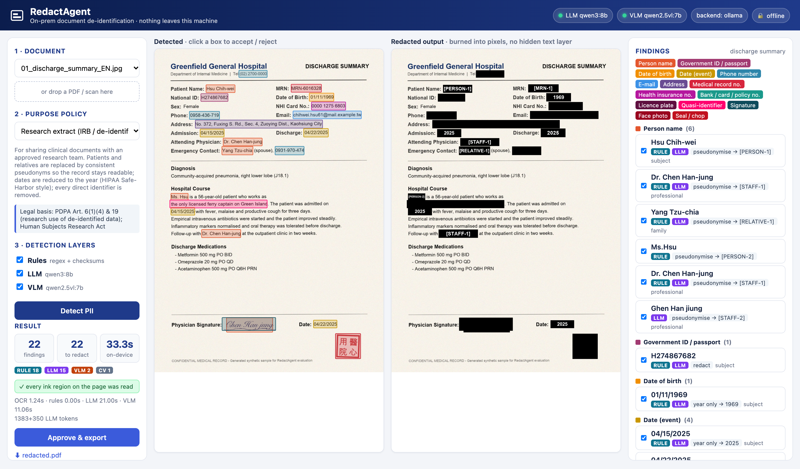

# RedactAgent

**On-premises AI that finds and removes personal data from scanned documents** – so hospitals,
law firms and government agencies can share records without the records ever leaving the building.

**2026 ASUS UGen AI League – Final** · Battlefield **Thunderstorm** (ASUS UGen Intel Arc Pro B70) ·
Theme **Workplace AI** · Global Online Track · Yu-Tsen Tsai (蔡侑岑), CSIE, National Taiwan University.

| | |
|---|---|
| Final demo video (≤ 10 min) | _to be added_ |
| Stage I demo (3 min) | https://youtu.be/LxvyFA2Zhrc |
| Engineering log (Stage II) | [`docs/STAGE2_LOG.md`](docs/STAGE2_LOG.md) |
| Model information | [`docs/MODELS.md`](docs/MODELS.md) |
| Performance data | [`eval/results_b70/`](eval/results_b70/) · [`eval/tune/`](eval/tune/) |



## What it does

1. **Ingest** a PDF, scan or phone photo (English + Traditional Chinese), one or a whole batch.
2. **Read** it with PP-OCR (RapidOCR / ONNX Runtime) – one box per character.
3. **Detect** personal data with complementary layers
   - **Rules** – regex + checksums (Taiwan national ID, Luhn cards, NHI, MRN, ROC dates …), form-field anchoring
     (姓名 / 住址 / Name / Address / court-judgment party lines), organisation letterheads excluded.
   - **Contextual LLM** (Qwen3) – names in prose, addresses, each person's *role*, quasi-identifiers
     ("the only ferry captain on Green Island").
   - **Vision** (Qwen2.5-VL grounding + red-ink colour segmentation) – signatures, ID photos, seals (印章).
   - **Agentic re-identification check** – an adversarial LLM pass reads the *redacted* text, reports anything that
     could still identify a person and gives the page a 0–100 re-identification risk score.
4. **Decide** with a purpose policy (YAML): research (IRB), court filing, public release (FOI) or strict –
   redact, pseudonymise consistently (`[PERSON-1]`), keep the year only, or keep.
5. **Review** every box in the browser; an unread-ink check flags any text the OCR skipped.
6. **Export** a pixel-burned PDF (no hidden text layer), de-identified text and a JSON report; every step is
   appended to a **SHA-256 hash-chained audit log**.

Nothing is sent to the internet: OCR, models and audit all run on the machine.

## Architecture on 2x Intel Arc Pro B70


Each Arc Pro B70 serves one model through vLLM XPU (`ZE_AFFINITY_MASK=0` text LLM, `=1` vision model), so the LLM
and VLM layers of a page run concurrently and both models stay resident. OCR and rules run on the Xeon host.
Pages: `/` single-document review, `/batch` many documents in flight, `/system` live host / GPU / model status.

## Results

_Final numbers (held-out corpus v3, final configuration) will be filled in after the final run; see
[`docs/STAGE2_LOG.md`](docs/STAGE2_LOG.md) for every intermediate measurement._

Measured so far on the B70 host:

- Accuracy parity with the laptop prototype on corpus v1 (recall 97.8 %, precision 97.1 %).
- 23 → 27.5 pages/min with Qwen3-8B FP8 and the agentic check, 8 pages in flight
  (laptop: ~2 pages/min).
- OCR bottleneck found and removed: 9x faster OCR by capping ONNX Runtime threads per engine.
- Held-out document types (v2) exposed a generalisation gap (84 % recall); error analysis + the agentic check
  raised it to 94.4 %.

## Quick start

### On an Intel Arc Pro B70 x2 host (vLLM XPU)

```bash
git clone https://github.com/bananabbgun/RedactAgent.git && cd RedactAgent
bash deploy/b70/up.sh            # pulls models, starts one vLLM server per card, then the web UI on :8080
```

Model choice and quantisation are environment variables (see the header of `deploy/b70/up.sh`).

### On a laptop (Ollama)

```bash
ollama pull qwen3:8b && ollama pull qwen2.5vl:7b
python3.12 -m venv .venv && source .venv/bin/activate && pip install -r requirements.txt
python -m redactagent.server        # http://127.0.0.1:8080
```

## Reproducing the evaluation

| Corpus | Purpose | Pages / PII items |
|---|---|---|
| `data/synthetic` (v1) | development: six document types used while writing prompts and rules | 36 / 582 |
| `data/synthetic_v2` | held-out: five new document types, unseen quasi-identifiers, half phone photos; used for error analysis | 30 / 396 |
| `data/synthetic_v3` | final check: v2 document types with a fresh seed, generated before any result was seen | 30 / 396 |

```bash
python eval/evaluate.py --workers 8 --data data/synthetic_v3 --out eval/results_b70/v3   # recall / precision, ablations A-D
python eval/benchmark.py --levels 1,4,8,16 --out eval/results_b70/bench                    # throughput, latency, power
python -m pytest -q tests                                                                 # unit tests (no models needed)
```

Scoring is pixel-level: a ground-truth item counts as removed when ≥ 50 % of its area is covered by redaction boxes;
a redaction box is correct when ≥ 30 % of its area overlaps ground-truth PII. Ablations: A rules + colour,
B + contextual LLM, C + VLM, D + agentic re-identification check.

A small user study (manual vs. AI-assisted redaction, `/study`, scored with `eval/study_score.py`) measures time
per page and completeness with people in the loop.

## Repository layout

| Path | Content |
|---|---|
| `redactagent/` | pipeline, OCR, detectors (`rules.py`, `llm.py`, `vision.py`), agentic `verifier.py`, policy engine, renderer, audit log, hardware telemetry, server |
| `web/` | review UI, batch page, system page, user-study page (vanilla JS, works offline) |
| `policies/` | purpose policies (YAML) |
| `scripts/` | synthetic corpus generators (v1, v2/v3), demo recording and video tooling |
| `eval/` | evaluation harness, benchmark, study scorer, results (`results/` laptop, `results_b70/`, `tune/`) |
| `deploy/b70/` | one-command deployment for the Arc Pro B70 host |
| `docs/` | architecture diagram, model information, Stage II engineering log |
| `deck/` | proposal deck source |
| `tests/` | unit tests |

## Models and licences

All Apache-2.0 / MIT / BSD – see [`docs/MODELS.md`](docs/MODELS.md). No AGPL components, so the work can be licensed
for commercial use as the competition requires. RedactAgent itself is MIT.

## Data

All documents in this repository are **synthetic**: every name, ID number (with valid checksum), address and
account was randomly generated. No real personal data was used.

## Notes and limitations

- Policy legal bases are indicative and must be confirmed with counsel for each deployment.
- Synthetic documents approximate real scans; a supervised pilot on real documents is the next step.
- Human review stays mandatory: RedactAgent pre-marks, a person approves.
- XPU graph mode could not be used on this software stack (graph capture ran out of resources); all numbers are eager mode.
