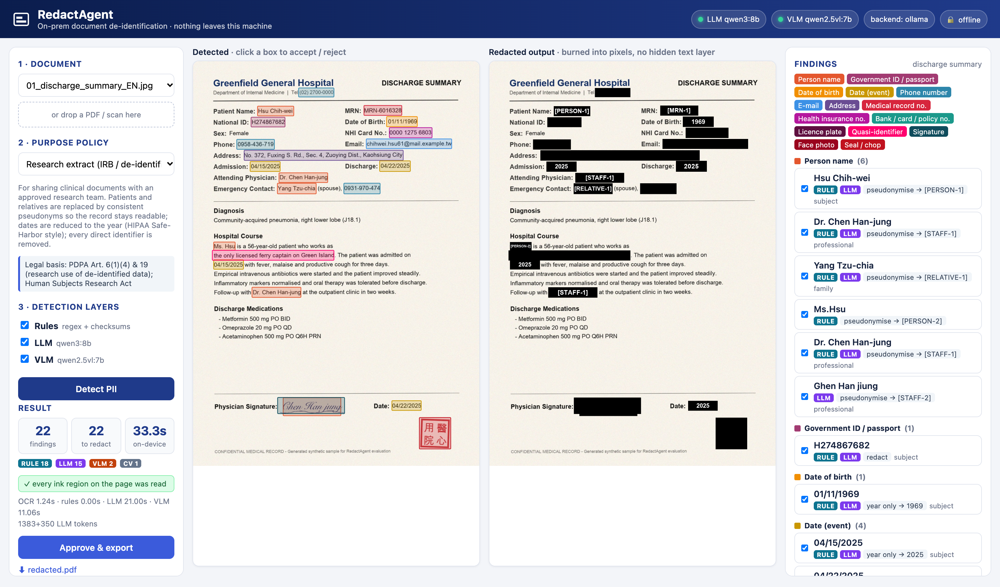

# RedactAgent

**On-premises AI that finds and removes personal data from scanned documents** – so hospitals,
law firms and government agencies can share records without the records ever leaving the building.

Entry for the **2026 ASUS UGen AI League** · Battlefield **Thunderstorm** (ASUS UGen Intel Arc Pro B70 32GB) ·
Theme **Workplace AI** · Global Online Track.
Author: Yu-Tsen Tsai (蔡侑岑), B12902026, CSIE, National Taiwan University.

**Demo video (3 min):** https://www.youtube.com/watch?v=DQx-QkbOOHc



## What it does

1. **Ingest** a PDF, scan or phone photo (English + Traditional Chinese).
2. **Read** it with PP-OCR (RapidOCR, ONNX Runtime / OpenVINO) – one box per character.
3. **Detect** personal data with three complementary layers
   - **Rules** – regex + checksums (Taiwan national ID, Luhn cards, NHI, MRN, ROC dates …) and form-field anchoring (姓名 / 住址 / Name / Address).
   - **Contextual LLM** (Qwen3) – names in prose, addresses, each person's *role*, quasi-identifiers ("the only ferry captain on Green Island").
   - **Vision** (Qwen2.5-VL grounding + red-ink colour segmentation) – signatures, ID photos, seals (印章).
4. **Decide** with a purpose policy (YAML): research (IRB), litigation, public release (FOI) or strict –
   redact, pseudonymise consistently (`[PERSON-1]`), keep the year only, or keep.
5. **Review** every box in the browser (accept / reject).
6. **Export** a pixel-burned PDF (no hidden text layer), de-identified text and a JSON report; every step is
   appended to a **SHA-256 hash-chained audit log**.

Nothing is sent to the internet: OCR, models and audit all run locally.

## Results (synthetic corpus, laptop prototype)

36 scanned pages, 582 ground-truth PII items, 6 document types (English + Traditional Chinese), pixel-level scoring:

| Configuration | Recall | Precision | Pages with zero leaks |
|---|---|---|---|
| Rules + colour only (regex/DLP baseline) | 76.5% | 97.4% | 0% |
| + contextual LLM (Qwen3-8B) | 96.4% | 96.9% | 52.8% |
| **+ VLM (Qwen2.5-VL-7B) = RedactAgent** | **97.8%** | **97.1%** | **72.2%** |

~30 s per page on an Apple M5 laptop (24 GB). Full per-category tables and latency per stage:
[`eval/results/RESULTS.md`](eval/results/RESULTS.md). Reproduce with `python eval/evaluate.py`.

## Quick start (laptop)

```bash
# 1. models (Ollama)
ollama pull qwen3:8b
ollama pull qwen2.5vl:7b

# 2. python env
python3.12 -m venv .venv && source .venv/bin/activate
pip install -r requirements.txt

# 3. run
python -m redactagent.server        # http://127.0.0.1:8080
```

Sample documents are in `data/samples/`. Regenerate the synthetic corpus with
`python scripts/make_synthetic.py` and evaluate with `python eval/evaluate.py`.

## On the ASUS UGen Intel Arc Pro B70

The code speaks both the Ollama API and the OpenAI-compatible API served by **vLLM XPU**, so moving to the
B70 is a configuration change:

```bash
RA_BACKEND=openai RA_BASE_URL=http://localhost:8000 RA_VISION_BASE_URL=http://localhost:8001 \
RA_TEXT_MODEL=Qwen/Qwen3-30B-A3B RA_VISION_MODEL=Qwen/Qwen2.5-VL-7B-Instruct python -m redactagent.server
```

See [`deploy/b70/`](deploy/b70/README.md) for the planned VRAM budget (text + vision models resident together
in 32 GB), the docker compose file and the Stage II validation plan.

## Architecture

```
browser (LAN) ──► FastAPI server ──► ingest ─► PP-OCR ─► rules ─┐
                     │                                LLM ─────┤► merge ─► policy ─► review ─► burned-in PDF
                     │                                VLM+colour┘                         └─► hash-chained audit
                     └── Ollama (laptop)  |  vLLM XPU on ASUS UGen Arc Pro B70 (Stage II)
```

| Path | Content |
|---|---|
| `redactagent/` | pipeline, OCR, detectors (`rules.py`, `llm.py`, `vision.py`), policy engine, renderer, audit log, server |
| `web/` | review UI (vanilla JS, works offline) |
| `policies/` | purpose policies (YAML) |
| `scripts/make_synthetic.py` | synthetic document generator with pixel-exact ground truth |
| `eval/` | evaluation harness and results |
| `deploy/b70/` | Arc Pro B70 deployment plan (vLLM XPU) |
| `deck/` | Stage I proposal deck source |

## Models and licenses

| Component | License |
|---|---|
| Qwen3-8B / Qwen3-30B-A3B | Apache-2.0 |
| Qwen2.5-VL-7B-Instruct | Apache-2.0 |
| PP-OCR models via RapidOCR | Apache-2.0 |
| FastAPI, pypdfium2, OpenCV, Pillow | MIT / Apache-2.0 / BSD |
| RedactAgent | MIT |

## Data

All documents in this repository are **synthetic**: every name, ID number (with valid checksum), address and
account was randomly generated. No real personal data was used.

## Notes and limitations

- Policy legal bases are indicative and must be confirmed with counsel for each deployment.
- The synthetic corpus approximates real scans; a supervised pilot on real documents is the next step.
- Human review stays mandatory: RedactAgent pre-marks, a person approves.
